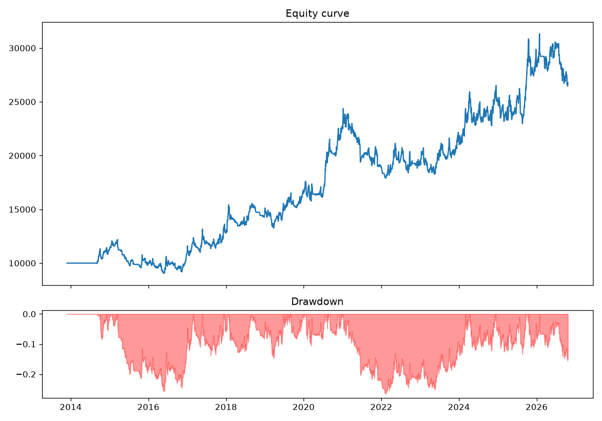

# Multi-Market Trend-Following Bot

A rules-based trading system that follows trends across US stock ETFs, Bitcoin, gold, silver and major currency pairs. It includes a portfolio backtester and a live/paper-trading connection to Interactive Brokers.

The goal of this project was to test, with real data, whether a classic trend-following strategy works across different asset classes, and how much risk it takes to earn its return.



## Strategy

| Rule | Detail |
|---|---|
| Entry | Close breaks above the 55-day high (long) or below the 55-day low (short) |
| Trend filter | Longs only above the 200-day moving average, shorts only below it |
| Exit | Close breaks the opposite 20-day channel, or a trailing stop 3 × ATR away |
| Position size | Each trade risks a fixed % of the account if its stop is hit |
| Portfolio limits | Max 8 positions, max 8% total open risk, 60-day pause after a 20% drawdown |

Markets: SPY, QQQ, IWM, Bitcoin, gold, silver, EUR/USD, GBP/USD, USD/JPY.

## Results

Daily data from Stooq, November 2013 to October 2026, $10,000 starting capital, 0.1% round-trip costs per side.

| Risk per trade | Ending value | Annual return | Max drawdown | Sharpe | Trades | Win rate | Profit factor |
|---|---|---|---|---|---|---|---|
| 1% | $15,128 | 3.3% | −16.7% | 0.38 | 423 | 39.2% | 1.24 |
| 2% | $26,801 | 7.9% | −26.5% | 0.53 | 363 | 41.9% | 1.35 |

Profit and loss by market at 2% risk:

| Market | Trades | P&L |
|---|---|---|
| Bitcoin | 29 | +$9,991 |
| Gold | 45 | +$6,260 |
| QQQ | 39 | +$5,285 |
| SPY | 43 | +$2,920 |
| Silver | 41 | +$2,069 |
| USD/JPY | 40 | −$703 |
| IWM | 33 | −$1,461 |
| EUR/USD | 45 | −$3,513 |
| GBP/USD | 48 | −$4,134 |

## Findings

1. **The strategy is profitable but modest.** 7.9% a year at 2% risk, with a 26.5% worst drawdown. Simply buying and holding SPY returned more over the same period.
2. **Diversification matters.** On SPY alone, the strategy earned only 0.6% a year. Across nine markets, gains in Bitcoin, gold and US tech offset losses elsewhere.
3. **Returns are concentrated.** At 1% risk, Bitcoin produced almost all of the profit. Results depend heavily on a few large trends, which may not repeat.
4. **Currencies lost money in every test.** I kept them in rather than removing them, because dropping whatever lost in the past is overfitting and would make the backtest look better without making the future better.
5. **Low win rate is normal here.** About 60% of trades lose. The strategy works because average wins are roughly twice the size of average losses.

## Issues found and fixed during development

- **Permanent drawdown stop.** The first version stopped trading forever after a 20% drawdown, so the equity could never recover. The 2% backtest made only 29 trades in 13 years. I replaced it with a 60-day pause.
- **Data source.** The original data library triggered a macOS security block during downloads. I removed it and switched to plain CSV files from Stooq, read with pandas only.

## How to run

```bash
pip3 install pandas numpy matplotlib
python3 backtest.py              # needs Stooq daily CSVs in Downloads or a data/ folder
python3 backtest.py --synthetic  # random data, to check the code runs
```

Settings such as risk per trade live in `config.py`. `live.py` connects to Interactive Brokers TWS (paper port 7497) and runs in dry-run mode by default, printing orders without sending them.

## Files

| File | Purpose |
|---|---|
| `config.py` | Risk, strategy and market settings |
| `strategy.py` | Indicators and entry/exit rules |
| `risk.py` | Position sizing and portfolio limits |
| `backtest.py` | Portfolio backtest and report |
| `live.py` | Interactive Brokers paper/live trading |

## Limitations

- Backtests ignore some real-world costs: wider spreads, crypto fees, overnight financing and slippage in fast markets.
- Gold and silver use spot prices; live trading may use different instruments.
- Past performance does not predict future returns. This project is for research and learning, not investment advice.

---

Built by Ram Prasad Pokharel with the help of an AI coding assistant (Claude).
